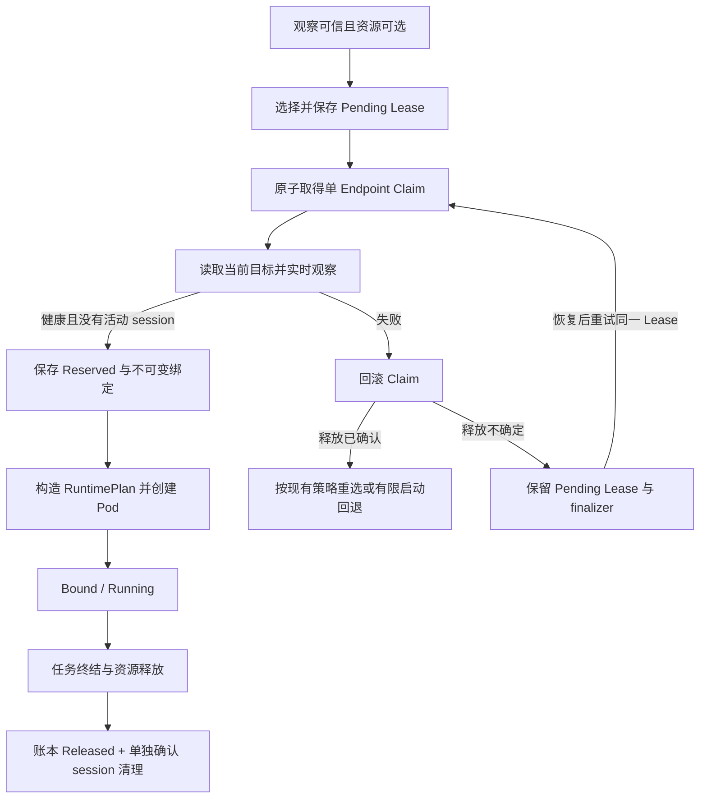

# 控制面逻辑梳理（2026-11-19）

后续进展：当日已部署可靠性版本，真实 K3s 矩阵 13/13 和资源复核通过，见 [K3s 验收记录](k3s-validation-report.zh-CN.md)。随后按正确性清单修复完成任务误回退、Claim 失败方清理与本地亲和性，整理已有生命周期和 Provider 公共代码；新版本已再次通过 13/13，见 [正确性审查](platform-correctness-review.zh-CN.md)。下文“本轮未部署”指先前的逻辑整理阶段，其推进路线中的部署验收现已完成。

总体架构合理，适合当前“单一独占 Remote Endpoint、本地 Device Plugin、有限启动回退”的实际能力。当前更需要收敛重复状态和错误处理，完成新版本部署验收；没有理由重写调度器或增加通用 Agent/插件框架。

## 应保持的职责

| 对象/组件 | 唯一职责 | 不能代替的事实 |
| --- | --- | --- |
| Endpoint 观察 | 记录这个 runtime 是否可观测、设备枚举与 session/cleanup 结果 | 不能承诺其他 native 进程没有占用整卡 |
| AcceleratorLease | 持久化本次分配、目标、运行时绑定、释放进度 | Pending 账本占用不等于已取得 Claim |
| coordination Lease Claim | 原子保护平台内 Endpoint 所有权 | Claim 成功不等于远端空闲或健康 |
| Provider | 厂商配置、观察适配、RuntimePlan | 不负责重写通用任务生命周期 |
| Allocator | 预留、绑定、释放及回滚 | 不负责 Pod 运行时注入或应用数值校验 |
| Workload Controller | 将上述阶段组织成可恢复的任务生命周期 | Ready 前回退不等于允许运行中自动重放任务 |

健康、占用、实际 session 和任务结果是不同事实，不能压成一个 Ready。现有重复探测也不应一概删除：周期观察服务于 Inventory/状态；Claim 后实时探测关闭旧状态窗口；创建 Pod 前复查确认选定目标没有变更或失效。

## 正常与失败路径

Released 表示平台所有权已完成释放；session 清理是否完成仍由观察结果确认。首次 Ready 后失败不进入启动回退，不默认重新执行已经运行的 kernel。

## 本轮已修改

### 1. 让注册表真正只有一份运行时来源

此前 Adapter Registry 保存一张 `{Provider, Allocator}` map，ProviderRegistry 又维护一张可独立注册的 map。调用 `registry.Providers().Register(provider)` 可以绕过 Allocator 配对，造成配置检查与实际执行解析不一致。

现在 Adapter Registry 是唯一可写的绑定来源。现有 ProviderRegistry API 保留为只读派生视图，Get/Drivers 从绑定来源读取，不复制 map，拒绝从视图单独注册 Provider。独立构造的 ProviderRegistry 仍可用于配置测试。

修改：`internal/adapter/registry.go`、`internal/contracts/registry.go`。新增 `registry_view_test.go`，验证独立注册被拒绝、后续完整注册能从已有视图立即读到、Provider 与 Allocator 一起解析。

### 2. 单 Endpoint 分配用单次事务表达

既然当前只支持一个独占 Endpoint，Reserve 就不应继续维护多目标排序、已见 Endpoint map、逐个 claim 列表与结果拼接。现在直接执行：校验一个目标 → 取得一个 Claim → 验证/观察 → 保存一个 binding。

格式错误在 Claim 前拒绝，避免没有意义的所有权写入。Release 仍清理历史记录中的全部目标并去重，不把新能力限制错误地套到旧资源回收上。

修改：`internal/allocation/remote.go`。新增 `remote_transaction_test.go`，覆盖输入无效不取得 Claim、历史多目标仍能清理。

### 3. 回滚失败必须优先于原始分配错误

原实现将分配错误与回滚错误简单 Join。如果第一个错误是 Conflict/Invalid，即使释放 Claim 失败，Controller 仍可能先匹配这个类别，把 Lease 标为 Failed、移除 finalizer，或消耗 fallback 次数。此时控制面并没有确认所有权已释放。

现在回滚失败的最外层类别是 Transient，原始错误与释放错误都保留为 cause。Controller 保存 `ReservationRetrying` 条件，保留同一个 Pending Lease、finalizer 和分配引用，交给现有重试/TTL/清理生命周期恢复，不新建 Pod、不消耗一次启动回退。

新增测试覆盖 Conflict 与 Invalid 两类原始错误；控制器回归测试使用 fake client 和故障注入，验证取得 Claim → 目标失效 → API 释放失败 → 保留所有权 → 重建 Controller → 故障恢复 → 原 Lease 成功绑定，确认不会增加第二个 Lease。这项测试不代表真实集群已完成同类故障验收。

修改：`internal/controller/workload_controller.go`。新增 `reservation_retry_test.go`。

## 本轮验收

- `make verify`：通过（fmt、vet、全量 Go 测试、manager 构建）。
- `go test -race ./...`：通过。
- envtest：真实 API Server/etcd 下 CRD 字段、并发 Claim 及释放后接续通过。
- `git diff --check`：通过。
- 原有 Controller fallback、重启、释放和观察测试均保留；没有改变 CRD 或运行时 wire protocol。
- 本轮未部署 K3s、未修改运行中服务、未提交或推送远端，也没有重复运行 GPU/NPU 实验并冒称新数据面结果。

测试记录及相对本轮开始前的增量补丁在 `docs/evidence/logic-review-20261119/`。它区别于相对 Git HEAD 的大 diff：后者还包含此前未提交的观察和镜像交付改动。

## 接下来按这个顺序推进

1. **冻结当前本地能力并做受控部署验收**：先确认测试 Endpoint 没有活动业务 Lease，再由具有相应权限的部署流程导入版本化镜像、核对同类 digest、部署新控制器/服务端/CRD。不要用特权调试 Pod 绕过主机权限。此次尚未执行部署。
2. **用真实 Kubernetes Workload 验证完整生命周期**：本地无可用设备时 Auto 选择 Remote；CoreX/MLU 数值正确；两个任务竞争同一 Endpoint 串行接续；server 故障时新任务排队；首次 Ready 后不重放；Controller 重启及删除后回收。独立进程和 Docker 实验不能替代这一步。
3. **验收后继续小范围整理代码**：将 Endpoint 的 IO 观察与状态推导拆开；CoreX/MLU 共享确实相同的 runtime-volume 构造；大 Controller 按已有阶段拆分。只提取实际复用的代码，保留 Provider 与 Allocator 的职责。
4. **最后才考虑规模优化**：在有压测证据后缩小 Inventory 查询、Pool 重算和提高并发。当前不提前增加多 Endpoint 聚合、复杂调度或运行中迁移。

这条路线的判断依据是：先让同一事实只有一个来源，事务能回滚且结果可恢复，再逐步减少代码重复。代码行数减少本身不是验收标准。
